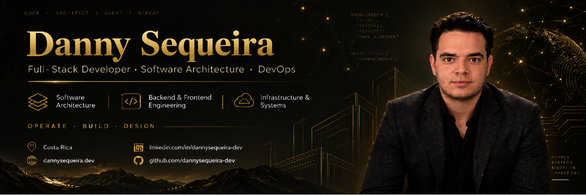

 

# Danny Sequeira

### Software Engineering · Architecture · Systems

**OPERATE · DESIGN · BUILD**

Building domain-heavy systems, thoughtful interfaces, and developer tools that are designed to last.

**Costa Rica 🇨🇷 · Open to software engineering opportunities**

 

---

## How I approach engineering

I work across the stack—from modeling business rules and designing service boundaries to shipping user interfaces, improving delivery pipelines, and operating software in production.

I gravitate toward **complex domains, reliable distributed systems, and developer experience**. My rule of thumb: make invariants explicit, keep boundaries intentional, verify behavior, and make failures observable.

| Focus | What I work with |
| --- | --- |
| **Backend & domains** | Java, Spring Boot, API design, DDD, hexagonal architecture, distributed workflows |
| **Frontend & DX** | TypeScript, React, Next.js, UI architecture, design systems |
| **Data & operations** | PostgreSQL, Redis, Docker, Linux, CI/CD, monitoring and observability |
| **Engineering practices** | Automated testing, contract thinking, release automation, technical documentation, ADRs |

## Featured open source: [Neshel-UI](https://github.com/dannysequeira-dev/neshel-ui)

**A modular, accessible React design system—built as independently installable packages, not a monolithic component library.**

Neshel-UI is published on npm (initial `0.1.0` release) and has five packages: configuration/tokens, layout, typography, components, and a build-time CLI. It supports plain CSS or optional Tailwind CSS v4 integration.

- **Architecture:** semantic design tokens, composable primitives, package boundaries, and documented decisions.
- **Confidence:** cross-platform CI, browser accessibility checks, packed-package consumer tests, and SSR/Next.js verification.
- **Developer experience:** TypeScript APIs, bilingual documentation, examples, and reproducible package distribution.

**Explore:** [Source](https://github.com/dannysequeira-dev/neshel-ui) · [Documentation & examples](https://neshel-ui.vercel.app) · [Architecture](https://github.com/dannysequeira-dev/neshel-ui/blob/main/docs/architecture.md) · [Decision records](https://github.com/dannysequeira-dev/neshel-ui/tree/main/docs/decisions)

## Other engineering work

**Sportsbook platforms · Professional, proprietary work**

Experience building player-facing betting experiences and operational tooling: real-time sports data, betslip behavior and validation, odds-management workflows, frontend architecture, and service integration. This production code is not public.

**[Yawa Backend](https://github.com/dannysequeira-dev/yawa-backend) · Public Java/Spring codebase**

A banking/account-services project exploring domain-driven modeling and distributed systems patterns, including hexagonal architecture, Saga, and transactional Outbox.

**[Garage Platform](https://github.com/dannysequeira-dev/garage-platform) · Architecture exploration**

Documenting a vehicle-lifecycle domain, ownership and maintenance boundaries, and event-driven integration choices. **Currently in the architecture phase; implementation has not started.**

## GitHub activity

 

 

These are GitHub API snapshots, not a measure of engineering experience. Most proprietary work is not represented here.

---

### Let's build something worth maintaining.

I enjoy conversations about architecture, complex product domains, and building software that teams can understand and operate.

**[Portfolio & writing](https://dannysequeira.dev) · [Connect on LinkedIn](https://www.linkedin.com/in/dannysequeira-dev/)**

Think → Design → Build → Operate → Improve

